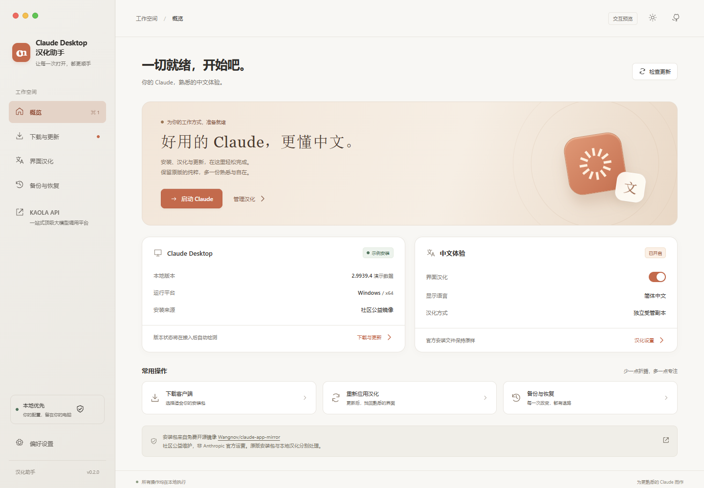

# Claude Desktop 汉化助手

**为 Claude Desktop 提供中文界面、镜像下载与更新、独立副本和备份恢复的图形化助手。**

Claude Desktop Chinese localization & update assistant for Windows and macOS (preview).

[使用教程](https://shibaweidu.github.io/claude-cn-assistant/) · [下载预览版](https://github.com/shibaweidu/claude-cn-assistant/releases) · [常见问题](https://shibaweidu.github.io/claude-cn-assistant/faq/) · [报告问题](https://github.com/shibaweidu/claude-cn-assistant/issues/new/choose)

[](LICENSE)
[](https://github.com/shibaweidu/claude-cn-assistant/actions/workflows/macos.yml)



*上图为浏览器界面预览，使用示例状态，不代表真实安装或兼容性验收。*

## 能做什么

- **中文界面**：基于本机原版制作独立中文副本，原版安装和对话文件保持原样。
- **镜像下载与更新**：仅使用指定的 [Wangnov/claude-app-mirror](https://github.com/Wangnov/claude-app-mirror)，提供公益加速与 GitHub Releases 备用渠道。
- **暂停与断点续传**：同版本、大小、SHA256 匹配时复用下载进度；完成后校验完整文件。
- **安装确认**：下载后自动检查安装包；Claude 运行时询问是否强制退出，确认后才继续。
- **状态同步**：显示原版／中文版运行状态、安装检查和实际安装结果。
- **备份与恢复**：重新制作或恢复中文副本时保留旧副本，支持处理中断的目录切换。

本项目汉化 **Claude Desktop 桌面客户端**，不是 Claude Code 命令行汉化工具，也不提供账号、订阅或第三方 API 服务。非 Anthropic 官方产品。

## 下载与平台支持

当前版本：**0.2.0 预览版**。前往 [Releases](https://github.com/shibaweidu/claude-cn-assistant/releases) 下载对应架构，校验同页的 `SHA256SUMS.txt`。

| 平台 | 助手与汉化 | 验证范围 | 教程 |
| --- | --- | --- | --- |
| Windows x64 | 预览版 | 已实测镜像包检查、中文副本制作与启动注入；完整覆盖不保证 | [Windows 教程](https://shibaweidu.github.io/claude-cn-assistant/windows/) |
| macOS Apple Silicon | 预览版 | 原生自动化测试与打包通过；真实 Claude 完整流程待验收 | [Mac 教程](https://shibaweidu.github.io/claude-cn-assistant/macos/) |
| macOS Intel | 预览版 | 原生自动化测试与打包通过；真实 Claude 完整流程待验收 | [Mac 教程](https://shibaweidu.github.io/claude-cn-assistant/macos/) |
| Linux / Windows ARM64 助手 | 暂不提供 | 可下载镜像中的对应客户端包，不代表助手或汉化已适配 | [兼容性](https://shibaweidu.github.io/claude-cn-assistant/compatibility/) |

启动中文副本需要 **Node.js 22 或更新版本**。macOS 助手尚未做 Apple 公证。当前只处理 `ion-dist.asar` 布局；其他布局会停止处理。

## 三步开始

1. **下载助手**：解压对应预览包；Mac 的 ZIP 内还有一个 `tar.gz`，继续解压以保留应用权限与框架链接。
2. **找到原版**：在概览检测已安装的 Claude；尚未安装时，前往「下载与更新」从指定镜像下载，按提示确认安装。
3. **制作中文版**：进入「界面汉化」制作中文副本，再点击「启动中文版」。原版运行时可选择「强制退出并汉化」，执行前请保存未完成的内容。

Windows 更新交由系统安装器完成；macOS 更新安装到当前用户的 `~/Applications/Claude.app`。安装结果依据本机实际版本确认。**原版更新后，需重新制作中文副本，才能使用新版的中文副本。**

## 常见问题

### 为什么要制作副本？

汉化只修改独立受管副本，便于保留原版、恢复旧副本和检查文件完整性。副本会占用额外磁盘空间。它与原版共享 Claude 自身的账户环境；助手不修改对话文件。

### 为什么还有英文？

词表不覆盖所有版本和功能。Claude 6.28899.6 的英文主词表中仍存在未覆盖的键；不能把“与上游词表一致”理解为“全部翻译”。详见[兼容性说明](https://shibaweidu.github.io/claude-cn-assistant/compatibility/)。

### 自动更新会直接关闭 Claude 吗？

不会。助手运行时每 6 小时检查版本；下载完成后进入安装检查和确认。强制退出需要本次明确确认，取消不会关闭 Claude。它不是无人值守静默安装。

### 更新后中文版为什么还是旧版？

原版安装和中文副本分别管理。更新原版不会替换现有中文副本，请重新制作。更新后自动重建偏好尚未执行。[更新教程](https://shibaweidu.github.io/claude-cn-assistant/update/)

更多问题：[启动失败、签名检查、下载中断和恢复](https://shibaweidu.github.io/claude-cn-assistant/troubleshooting/)。

## 从源码运行

需要 Node.js 22+、Rust stable。Windows 还需 Visual Studio C++ Build Tools、Windows SDK 与 WebView2；Mac 需要 Xcode Command Line Tools。

```sh
npm ci
npm run desktop:dev
```

```sh
npm run check
node --test tests/update-flow.test.cjs
cargo test -p assistant-core --locked
npm run desktop:build -- --no-bundle
```

文档站：`npm run site:build`。浏览器演示：`npm run web:dev`；演示数据不等于桌面服务的实际结果。

开发记录见 [DEVELOPMENT_PLAN.md](DEVELOPMENT_PLAN.md)、[macOS 实现说明](docs/MACOS_SUPPORT.md) 和 `docs/` 下的验证文档。

## 数据与恢复

| 系统 | 助手数据目录 |
| --- | --- |
| Windows | `%LOCALAPPDATA%\ClaudeCnAssistant` |
| macOS | `~/Library/Application Support/ClaudeCnAssistant` |

数据目录包含设置、下载缓存、受管副本、备份及诊断日志。恢复只切换受管副本，不回退 Claude 账号或对话。提交日志前请删除个人路径、账号及其他敏感信息。

## 许可证

[AGPL-3.0-only](LICENSE) · [第三方声明](THIRD_PARTY_NOTICES.md)
